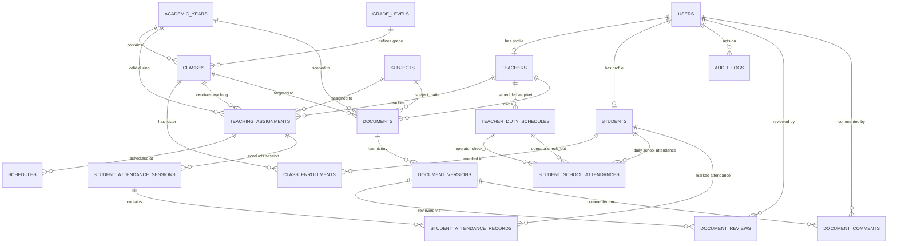

# BLUEPRINT ARSITEKTUR SISTEM & DATABASE
## APLIKASI PORTAL SEKOLAH

**Nomor Dokumen:** ARCH-SEKOLAH-002  
**Referensi Induk:** PRD-SEKOLAH-001 (`01-product-requirements.md`)  
**Versi Dokumen:** 2.1.0 (FINAL — ADDENDUM + Keputusan A1/B2/C1 disahkan)  
**Status:** APPROVED FOR DEVELOPMENT  
**Role Penyusun:** Senior Software Architect, Senior Laravel Architect, Senior Database Architect & Senior System Analyst  
**Tanggal Revisi ADDENDUM:** 2026-09-27 · **Finalisasi Keputusan:** 2026-09-27  

---

## DAFTAR ISI
1. [Prinsip Arsitektur & Pedoman Desain](#1-prinsip-arsitektur--pedoman-desain)
2. [Arsitektur Aplikasi & Modular Monolith](#2-arsitektur-aplikasi--modular-monolith)
3. [Arsitektur Layering & Tanggung Jawab Komponen](#3-arsitektur-layering--tanggung-jawab-komponen)
4. [Arsitektur Autentikasi, Otorisasi (RBAC) & Proteksi Keamanan](#4-arsitektur-autentikasi-otorisasi-rbac--proteksi-keamanan)
5. [Arsitektur Service Layer & Business Logic Boundary](#5-arsitektur-service-layer--business-logic-boundary)
6. [Arsitektur Routing & Middleware Pipeline](#6-arsitektur-routing--middleware-pipeline)
7. [Boundary & Pola Integrasi Google Drive](#7-boundary--pola-integrasi-google-drive)
8. [Arsitektur Database MySQL & Integritas Data](#8-arsitektur-database-mysql--integritas-data)
9. [Entity Relationship Diagram (ERD) Konseptual & Logikal](#9-entity-relationship-diagram-erd-konseptual--logikal)
10. [Data Dictionary & Struktur Tabel Terinci](#10-data-dictionary--struktur-tabel-terinci)
11. [Desain Dynamic Class & Progresi Siswa Antar Tahun Ajaran](#11-desain-dynamic-class--progresi-siswa-antar-tahun-ajaran)
12. [Desain Teaching Assignment & Penjadwalan (Schedules)](#12-desain-teaching-assignment--penjadwalan-schedules)
13. [Desain Document Repository, Versioning & Review Workflow](#13-desain-document-repository-versioning--review-workflow)
14. [Desain Absensi Masuk/Pulang Sekolah & Jadwal Guru Piket](#14-desain-absensi-masukpulang-sekolah--jadwal-guru-piket-addendum)
15. [Desain Absensi Siswa Per Mata Pelajaran (Session & Records)](#15-desain-absensi-siswa-per-mata-pelajaran-session--records)
16. [Desain Audit Trail & System Logging](#16-desain-audit-trail--system-logging)
17. [Database Constraints, Indexing & Query Optimization](#17-database-constraints-indexing--query-optimization)
18. [Strategi Integritas Antar-Modul & Pencegahan Orphan Data](#18-strategi-integritas-antar-modul--pencegahan-orphan-data)
19. [Pertimbangan Skalabilitas Realistis](#19-pertimbangan-skalabilitas-realistis)
20. [Security by Design Baseline](#20-security-by-design-baseline)
21. [Simplicity & Anti-Overengineering Review](#21-simplicity--anti-overengineering-review)
22. [Architectural Decision Records (FINAL & OBSOLETE)](#22-architectural-decision-records-final--obsolete)

---

## 1. PRINSIP ARSITEKTUR & PEDOMAN DESAIN

Rancangan arsitektur dan skema database Portal Sekolah mengacu pada urutan prioritas yang ditetapkan:
1. **Security:** Autentikasi ketat, otorisasi berbasis resource (*server-side Policy*), pencegahan IDOR (*Insecure Direct Object Reference*), serta perlindungan CSRF/XSS/SQLi.
2. **Kesesuaian Spesifikasi PRD:** Menepati seluruh klausul fungsional pada `01-product-requirements.md` (termasuk ketiadaan RFID secara mutlak).
3. **Integritas Database (Data Integrity):** Memanfaatkan kapabilitas native relational database MySQL (InnoDB engine, Foreign Keys, Unique Constraints, Check Constraints, Transactions) untuk memastikan data tidak dapat rusak meskipun terjadi anomali aplikasi.
4. **Kesederhanaan (Simplicity):** Pola *Laravel Modular Monolith*. Tanpa microservices, message broker terpisah, ataupun SPA frontend. Lingkungan pengembangan lokal didukung oleh Laragon (Windows), dan siap dideploy ke server/hosting produksi berbasis MySQL.
5. **Maintainability:** Pembagian layer yang tegas (Route $\rightarrow$ Controller $\rightarrow$ FormRequest $\rightarrow$ Policy $\rightarrow$ Service/Action $\rightarrow$ Eloquent Model $\rightarrow$ MySQL).
6. **Realistic Scalability:** Mampu menangani pertumbuhan sekolah dari 1 kelas (27 siswa) menjadi puluhan rombel, ratusan guru, dan ribuan siswa tanpa refaktorisasi basis data.

---

## 2. ARSITEKTUR APLIKASI & MODULAR MONOLITH

Sistem dibangun dengan arsitektur **Laravel Monolith Modern** yang dikelompokkan secara modular (*Domain-driven/Feature-based folders inside standard Laravel conventions*). Seluruh proses berjalan dalam satu *runtime application instance* yang terhubung ke satu *database* MySQL (InnoDB).

```
+-----------------------------------------------------------------------------------+
|                                 PORTAL SEKOLAH                                    |
|                               (Laravel Monolith)                                  |
+-----------------------------------------------------------------------------------+
| [Presentation Layer]      Blade Templates + Tailwind CSS + Vanilla JS + Vite      |
+-----------------------------------------------------------------------------------+
| [HTTP & Routing Layer]    Route Groups (web.php) + Auth/Role Middleware           |
|                           Controllers + Form Requests (Validation)               |
+-----------------------------------------------------------------------------------+
| [Security & Auth Layer]   Session Guard + Argon2id Hash + Gate & Policies         |
+-----------------------------------------------------------------------------------+
| [Application / Service]   Action & Service Classes (Domain Logic)                 |
|                           (Upload, Versioning, Review, Attendance, Audit)        |
+-----------------------------------------------------------------------------------+
| [Data Access Layer]       Eloquent ORM Models + Query Scopes + Database Migrations|
+-----------------------------------------------------------------------------------+
| [External Boundary]       Google Drive API Client (Flysystem Storage Driver)      |
+-----------------------------------------------------------------------------------+
| [Persistence Layer]       MySQL 8.0+ (InnoDB Tables, Constraints, Indexes, Views) |
+-----------------------------------------------------------------------------------+
```

### Modul Fungsional Aplikasi
Aplikasi dibagi ke dalam 8 (delapan) modul fungsional yang terisolasi secara logis:
1. **Module Auth & User:** Mengelola login, session, password management, dan role resolution.
2. **Module Academic Core:** Mengelola tahun ajaran, semester, tingkat (grade levels), rombel (classes), siswa, dan pendaftaran siswa (*class enrollment*).
3. **Module Staff & Teaching:** Mengelola profil guru, mata pelajaran, penugasan mengajar (*teaching assignments*), dan jadwal (*schedules*).
4. **Module Document Repository:** Mengelola metadata dokumen perangkat ajar, siklus unggah berkas, dan histori versi (*immutable versions*).
5. **Module Document Review:** Mengelola peninjauan dokumen oleh Atasan, alur status approval/revisi, dan umpan balik komentar.
6. **Module Student School Attendance (ADDENDUM):** Mengelola scanner barcode absensi masuk/pulang siswa — validasi jadwal piket server-side per request, pencatatan `check_in`/`check_out` dengan stempel waktu server, pencegahan duplikasi, koreksi Admin, dan pelaporan kehadiran siswa. ~~(Menggantikan Module Teacher Attendance — DIHAPUS TOTAL, ADDENDUM §20 & §26.)~~
6b. **Module Teacher Duty Schedule (ADDENDUM §8–§18):** Mengelola CRUD jadwal piket guru oleh Admin/TU; menjadi sumber kebenaran hak akses scanner; seluruh perubahan diaudit.
7. **Module Student Subject Attendance:** Mengelola pembukaan sesi absensi jam pelajaran oleh guru pengampu, pencatatan status siswa (H/I/S/A), penguncian sesi, dan koreksi data.
8. **Module Audit & Reporting:** Mencatat jejak audit mutasi data sensitif, agregasi statistik dashboard, dan penyusunan ekspor data (Excel/PDF).

---

## 3. ARSITEKTUR LAYERING & TANGGUNG JAWAB KOMPONEN

Untuk mencegah terjadinya *Fat Controller* ataupun *Anemic Domain Model*, ditetapkan batas tanggung jawab (*Separation of Concerns*):

```text
HTTP Request 
     |
     v
[Route] -------------------> Mengidentifikasi URI, HTTP Method & mendaftarkan Middleware
     |
     v
[Middleware] --------------> Memverifikasi Autentikasi Session, Status Aktif User & Role
     |
     v
[Form Request] ------------> Memvalidasi tipe/aturan input & validasi otorisasi awal level request
     |
     v
[Policy / Gate] -----------> Memverifikasi otorisasi resource-level (Ownership, Assignment Scope)
     |
     v
[Controller] --------------> Orkestrator alur: menerima request bersih, memanggil Service/Action
     |
     v
[Service / Action] --------> Menjalankan business logic murni, orchestrate DB Transaction & Cloud API
     |
     v
[Eloquent Model / Query] --> Interaksi dengan tabel MySQL (relasi, scope, query builder)
     |
     v
[Blade View / Response] ---> Rendering antarmuka HTML dengan Tailwind CSS atau redirect HTTP
```

### Pembagian Tanggung Jawab Spesifik:
1. **Routes (`routes/web.php`):**
   * Hanya mendaftarkan URL, parameter rute, pemetaan controller, nama rute (*named routes*), dan grup middleware. Dilarang menempatkan Closure logic di file rute.
2. **Controllers (`app/Http/Controllers/`):**
   * Bersifat ramping (*Lean Controllers*).
   * Menangani injeksi dependency, memanggil Form Request, memicu Policy check via `$this->authorize()`, mendelegasikan proses mutasi data ke Service/Action class, dan mengembalikan `view()` atau `redirect()`.
3. **Form Requests (`app/Http/Requests/`):**
   * Mengisolasi seluruh aturan validasi (*validation rules*) dan pesan galat (*custom messages*).
   * Melakukan sanitasi data input awal.
4. **Policies (`app/Policies/`):**
   * Berisi seluruh aturan otorisasi berbasis model (contoh: `DocumentPolicy`, `AttendanceSessionPolicy`).
   * Melindungi dari serangan IDOR dengan mengecek apakah user ID sama dengan pemilik data atau berada dalam *teaching assignment* yang sah.
5. **Service / Action Classes (`app/Services/`):**
   * Mengenkapsulasi alur bisnis yang melibatkan beberapa langkah database, kalkulasi status dokumen, transaksi atomik (`DB::transaction`), atau interaksi eksternal (Google Drive).
6. **Eloquent Models (`app/Models/`):**
   * Mendefinisikan relasi antar-tabel, mutator/accessor, query scopes (contoh: `scopeActiveYear`, `scopePendingReview`), serta *casts* atribut.

---

## 4. ARSITEKTUR AUTENTIKASI, OTORISASI (RBAC) & PROTEKSI KEAMANAN

### 4.1 Strategi Autentikasi
* Menggunakan bawaan **Laravel Session-based Authentication** via HTTP Cookies yang aman (`HttpOnly`, `SameSite=Lax`, `Secure` over HTTPS).
* Hashing kata sandi menggunakan algoritma **Argon2id** (atau Bcrypt dengan cost factor $\ge 12$).
* **Penanganan User Nonaktif:** Status akun divalidasi pada setiap request melalui global middleware `EnsureUserIsActive`. Jika kolom `users.is_active = FALSE`, session dibatalkan (*invalidated*) seketika dan diarahkan ke halaman login dengan pesan penonaktifan.
* **Proteksi Brute-Force:** Memanfaatkan Laravel Rate Limiting (`RateLimiter`) pada endpoint login: maksimal 5 kali percobaan gagal per IP/NIP per 60 detik.

### 4.2 Strategi Role & Authorization (RBAC)
Sistem memiliki 3 (tiga) peran hierarkis:
1. `admin` (Admin / Staff Tata Usaha)
2. `teacher` (Guru)
3. `supervisor` (Atasan / Kepala Sekolah / Pengawas)

#### Keputusan Arsitektur Role:
* **Tidak Menggunakan Pivot Table / Permission Table yang Rumit:** Pada tahap MVP, sistem **TIDAK** membutuhkan paket kompleks seperti Spatie Permission dengan puluhan tabel pivot (`roles`, `permissions`, `model_has_permissions`).
* **Justifikasi:** Kebutuhan otorisasi Portal Sekolah bersifat *strictly role-based* dan *resource-scoped* (kewenangan ditentukan oleh relasi data penugasan, bukan izin atomik arbitrer). 
* Role disimpan secara efisien sebagai kolom `role` bertipe `VARCHAR(20)` dengan `CHECK (role IN ('admin', 'teacher', 'supervisor'))` pada tabel `users`.
* Jika seorang pengguna memiliki peran ganda (contoh: Guru yang juga menjadi Wakil Kepala Sekolah/Supervisor), diterapkan kebijakan **dua akun terpisah** — satu akun NIP untuk mengajar, satu akun khusus supervisi (ADR 04 — `[FINAL]`, lihat Bab 22).

### 4.3 Matriks Pencegahan Privilege Escalation & IDOR

| Jalur Serangan Potensial | Dampak Risiko | Mekanisme Pertahanan Server-Side |
| :--- | :--- | :--- |
| **Manipulasi Role pada Form Registrasi/Edit** | User mengangkat diri menjadi Admin | Tidak ada endpoint registrasi publik. Pembuatan user hanya melalui panel Admin via Form Request yang memvalidasi role secara eksplisit. |
| **IDOR pada Absensi Siswa Mapel (`/attendance/session/{id}`)** | Guru A menginput absensi kelas Guru B | `AttendanceSessionPolicy@update`: Melakukan query cek silang apakah `session.teacher_id == auth()->user()->teacher->id`. Jika tidak cocok, lempar HTTP 403. |
| **Pemalsuan Akses Scanner (`/guru/school-attendance-scanner`)** | Guru bukan piket membuka URL scanner langsung / jadwal dicabut saat halaman terbuka | Server-side `DutySchedulePolicy` mengecek ulang `teacher_duty_schedules` pada **setiap request** (buka halaman & submit scan) menggunakan **tanggal server**. Tidak cocok → HTTP 403 + pesan "Jadwal piket Anda telah berubah." (ADDENDUM §12–§14) |
| **Pemalsuan payload scan (mode/operator/tanggal)** | Guru memalsukan `scan_mode`, `teacher_id`, atau `attendance_date` pada request | Form Request memvalidasi enum mode (`MASUK`/`PULANG`); operator diambil dari sesi login (bukan input klien); tanggal selalu dari server (ADDENDUM §2, §23) |
| **IDOR pada Berkas Dokumen Guru (`/documents/{id}/edit`)** | Guru A mengubah dokumen Guru B | `DocumentPolicy@update`: Memvalidasi bahwa `document.teacher_id == auth()->user()->teacher->id` DAN `document.status == 'DRAFT'`. |
| **IDOR pada Unduh Berkas Privat** | User publik mengunduh berkas RPP via ID | Rute unduh dokumen melalui Controller proxy (`DocumentDownloadController`) yang memvalidasi otorisasi user sebelum mengalirkan *stream* berkas dari Google Drive. URL Google Drive tidak pernah diekspos langsung ke browser publik. |
| **Tampering Status Dokumen** | Guru mengubah status dokumen menjadi `DISETUJUI` | Controller tidak menerima parameter status mentah dari request body. Transisi status dikendalikan oleh Action class terisolasi (`ApproveDocumentAction`, `SubmitDocumentAction`) yang membatasi hak akses per role. |

---

## 5. ARSITEKTUR SERVICE LAYER & BUSINESS LOGIC BOUNDARY

Prinsip dasar Service Layer pada Portal Sekolah:
> *"Buat Service/Action hanya jika ada orkestrasi bisnis kompleks, transaksi multi-tabel, atau pemanggilan layanan eksternal. Gunakan Controller standar untuk operasi CRUD langsung."*

```
                    [Controllers]
                          |
         +----------------+----------------+
         |                                 |
         v                                 v
 (CRUD Sederhana)             (Logika Bisnis Kompleks)
         |                                 |
         v                                 v
  [Eloquent Model]                 [Service Classes]
                                           |
                    +----------------------+----------------------+
                    |                      |                      |
                    v                      v                      v
          [DocumentService]       [SchoolAttendance / SubjectAttendance Service]   [GoogleDriveService]
```

### 1. `GoogleDriveService`
* **Tanggung Jawab:** Mengabstraksi komunikasi API ke Google Drive.
* **Metode Utama:**
  * `uploadFile(UploadedFile $file, string $folderPath): string (fileId)`
  * `deleteFile(string $fileId): bool`
  * `getFileStream(string $fileId): StreamInterface`
  * `createFolderIfNotExist(string $path): string (folderId)`
* **Pola:** Menangani *exponential backoff retry* jika terjadi limit koneksi dari Google API.

### 2. `DocumentVersionService`
* **Tanggung Jawab:** Menangani siklus hidup berkas dan penomoran versi yang *immutable*.
* **Alur Eksekusi:**
  1. Menerima file upload dan metadata dari controller.
  2. Membuka transaksi database (`DB::beginTransaction`).
  3. Memanggil `GoogleDriveService::uploadFile`.
  4. Menghitung checksum SHA-256 berkas lokal untuk verifikasi integritas.
  5. Membuat record pada `document_versions` dengan `version_number = latest_version + 1`.
  6. Memperbarui `current_version_id` dan `status` pada tabel `documents`.
  7. Mencatat aksi ke `audit_logs`.
  8. Commit transaksi (`DB::commit`). Jika Google Drive gagal atau DB gagal, rollback sepenuhnya (*all-or-nothing*).

### 3. `DocumentReviewService`
* **Tanggung Jawab:** Memproses persetujuan atau permintaan revisi oleh Atasan.
* **Alur Eksekusi:**
  1. Memvalidasi bahwa status dokumen saat ini adalah `DIKIRIM` atau `REVISI`.
  2. Menyimpan record review pada `document_reviews` (dengan catatan wajib jika aksi = `REQUEST_REVISION`).
  3. Mengubah status dokumen pada tabel `documents` menjadi `PERLU_REVISI` atau `DISETUJUI`.
  4. Memicu notifikasi in-app ke Guru bersangkutan.
  5. Mencatat audit log.

### 4. `StudentSubjectAttendanceService`
* **Tanggung Jawab:** Mengatur pembukaan sesi absensi **per mata pelajaran**, inisialisasi default *pre-fill* Hadir, dan penguncian sesi.
* **Alur Eksekusi:**
  1. Validasi jadwal dan teaching assignment guru.
  2. Membuat `student_attendance_sessions` dengan status `OPEN`.
  3. Secara otomatis men-generate baris `student_attendance_records` untuk setiap siswa aktif di kelas tersebut dengan status default `HADIR`.
  4. Menyimpan perubahan status (H/I/S/A) saat guru mengunci sesi menjadi `CLOSED`.

### 4b. `SchoolAttendanceScanService` (ADDENDUM)
* **Tanggung Jawab:** Memproses hasil scan barcode absensi masuk/pulang sekolah oleh Guru Piket.
* **Alur Eksekusi:**
  1. **Verifikasi jadwal piket server-side** pada request ini: cek `teacher_duty_schedules` untuk `teacher_id` sesi login pada **tanggal server**. Bila tidak terjadwal → tolak (HTTP 403), jangan simpan apa pun.
  2. Validasi mode scan dari parameter tepercaya: `MASUK` atau `PULANG` (enum; mode tidak boleh disimpulkan dari jumlah scan).
  3. Resolusi siswa dari `students.barcode_code` hasil decode barcode.
  4. Ambil atau buat record `student_school_attendances` untuk `(student_id, attendance_date)` dalam satu transaksi.
  5. **Mode MASUK:** jika `check_in_time` sudah terisi → tolak duplikasi dan kembalikan informasi jam masuk yang sudah tercatat (application guard + `UNIQUE` constraint sebagai penjaga terakhir).
  6. **Mode PULANG:** jika `check_out_time` sudah terisi → tolak penimpaan dan kembalikan jam pulang yang sudah tercatat. Jika record hari itu tidak ada → **TOLAK scan (`[FINAL — KEPUTUSAN A1]`)**; sistem **dilarang** membuat `check_in` palsu atau auto-create record MASUK. Arahkan Guru Piket menghubungi Admin/TU; penyelesaian resmi melalui koreksi Admin (`SCHOOL_ATT_CORRECT` + alasan + audit).
  7. Isi kolom waktu dengan `CURRENT_TIMESTAMP` server dan operator (`check_in_by_teacher_id` / `check_out_by_teacher_id`) dari sesi login, bukan dari payload klien.
  8. Mencatat aksi `SCHOOL_ATT_SCAN` ke `audit_logs`.

### 4c. `TeacherDutyScheduleService` (ADDENDUM §8–§18)
* **Tanggung Jawab:** CRUD jadwal piket guru oleh Admin/TU dan penegakan auditing perubahan.
* **Alur Eksekusi:**
  1. Memvalidasi hak akses Admin/TU (Guru/Supervisor tidak memiliki hak ubah).
  2. Validasi data: `schedule_date` + `teacher_id` wajib ada; guru harus berstatus aktif.
  3. Menyimpan perubahan pada `teacher_duty_schedules` dalam transaksi database.
  4. Menulis audit log wajib (`DUTY_SCHEDULE_CREATE` / `UPDATE` / `DELETE`) berisi minimal: `actor`, `action`, tanggal jadwal, guru lama, guru baru, `timestamp`.
  5. **Tidak mengubah data historis:** perubahan jadwal hanya memengaruhi verifikasi akses scanner **setelah** perubahan tersimpan; record `student_school_attendances` yang telah ada (operator, waktu, siswa) tidak disentuh, termasuk saat mengubah jadwal masa lalu yang sudah memiliki record absensi.

### 5. `AttendanceCorrectionService`
* **Tanggung Jawab:** Mengakomodasi koreksi absensi siswa (masuk/pulang sekolah maupun per mata pelajaran) oleh Admin/Staff TU.
* **Alur Eksekusi:**
  1. Memvalidasi hak akses Admin.
  2. Memverifikasi kelengkapan alasan koreksi (minimal 10 karakter).
  3. Mengubah record kehadiran target.
  4. Menyimpan data historis nilai lama (*old_values*) dan nilai baru (*new_values*) ke tabel `audit_logs`.

---

## 6. ARSITEKTUR ROUTING & MIDDLEWARE PIPELINE

Struktur rute dikelompokkan secara terstruktur di `routes/web.php` berdasarkan hierarki peran (*Role-Based Route Prefixes*):

```text
/ (Redirect ke Login jika tamu, atau Dashboard sesuai role jika terautentikasi)
├── /login, /logout
│
├── /admin (Prefix: admin, As: admin., Middleware: ['auth', 'role:admin'])
│   ├── /dashboard
│   ├── /teachers
│   ├── /students
│   ├── /academic-years
│   ├── /classes
│   ├── /subjects
│   ├── /teaching-assignments
│   ├── /schedules
│   ├── /attendances (Monitoring & Koreksi Absensi Siswa Masuk/Pulang + Mapel)
│   ├── /school-attendances (Rekap absensi masuk/pulang siswa)
│   ├── /duty-schedules (CRUD Jadwal Guru Piket + Audit — ADDENDUM §9)
│   ├── /documents (Global Monitoring)
│   ├── /reports (Export Excel/PDF)
│   └── /audit-logs
│
├── /guru (Prefix: guru, As: guru., Middleware: ['auth', 'role:teacher'])
│   ├── /dashboard
│   ├── /profile
│   ├── /school-attendance-scanner (Scanner Barcode Masuk/Pulang — HANYA Guru Piket terjadwal; akses dikunci server bila bukan piket — ADDENDUM §8, §12, §19)
│   ├── /student-attendance (Pilih Kelas, Buka Sesi, Input H/I/S/A, Kunci)
│   └── /documents (Index Repositori, Upload Draft, Submit, Upload Revisi, Histori)
│
└── /supervisor (Prefix: supervisor, As: supervisor., Middleware: ['auth', 'role:supervisor'])
    ├── /dashboard
    ├── /teachers-repository (Monitoring Dokumen Seluruh Guru)
    ├── /reviews (Antrean Review Dokumen, Buka Berkas, Beri Feedback, Approve/Reject)
    └── /reports (Rekapitulasi Kepatuhan Dokumen)
```

### Middleware Pipeline:
1. `Authenticate` (`auth`): Memastikan request memiliki session valid.
2. `EnsureUserIsActive`: Memastikan user tidak berstatus nonaktif/dibekukan.
3. `CheckRole:admin|teacher|supervisor`: Memeriksa kolom `users.role`. Jika rute diakses oleh role yang tidak berhak, lemparkan `HTTP 403 Forbidden` (bukan redirect ke login).
4. `VerifyCsrfToken`: Melindungi seluruh form submission (POST/PUT/PATCH/DELETE) dari serangan CSRF.

---

## 7. BOUNDARY & POLA INTEGRASI GOOGLE DRIVE

Sistem menerapkan batas arsitektur yang ketat antara database aplikasi dan Google Drive:

```text
+-------------------------------------------------------------------------------+
|                             BATAS SISTEM STORAGE                              |
+-------------------------------------------------------------------------------+
|     DATABASE MYSQL (Metadata Only)    |  GOOGLE DRIVE (Private Cloud Storage) |
|  - File Name Asli & Sanitized         |  - File Binary (.pdf, .docx, .xlsx)   |
|  - Google Drive File ID               |  - Folder Tree Terstruktur            |
|  - File Size (Bytes)                  |  - Service Account Authentication     |
|  - MIME Type                          |  - Zero Public Web Access             |
|  - SHA-256 Checksum                   |                                       |
+-------------------------------------------------------------------------------+
```

### Aturan Batas (*Boundary Rules*):
1. **Tidak Ada File Binary di Database:** MySQL tidak pernah menyimpan kolom BLOB/LONGBLOB untuk berkas ajar guru.
2. **Tidak Ada Akses Publik Langsung:** Folder dan file di Google Drive berstatus *Private* (hanya dapat diakses oleh Google Service Account aplikasi). File **TIDAK** di-share ke publik ("Anyone with the link").
3. **Download Proxy Pattern:** Ketika Guru atau Supervisor ingin mengunduh/melihat dokumen, browser mengirim request ke endpoint aplikasi (`/documents/versions/{version_id}/download`). Server Laravel memvalidasi otorisasi (Policy), meminta stream file dari Google Drive API menggunakan Service Account, lalu mengalirkan stream (*stream response*) ke browser pengguna.
4. **Isolasi Kegagalan:** Jika koneksi ke Google Drive terputus saat upload, database transaction di-rollback sehingga tidak terbentuk record orphan tanpa file fisik.

---

## 8. ARSITEKTUR DATABASE MYSQL & INTEGRITAS DATA

### 8.1 Spesifikasi Tipe Data MySQL Terpilih
* **Engine Basis Data:** `InnoDB` (mendukung foreign key constraints, ACID transaction, row-level locking, dan crash recovery).
* **Primary Key:** `BIGINT UNSIGNED AUTO_INCREMENT` (kompatibel dengan Laravel `$table->id()`) untuk performa indexing B-Tree dan efisiensi join relasi internal yang tinggi. Proteksi IDOR ditegakkan pada level server-side authorization (Laravel Policy).
* **Foreign Key:** `BIGINT UNSIGNED` (harus bertipe identik dengan primary key referensinya).
* **String & Teks:** `VARCHAR(n)` dengan charset `utf8mb4` dan collation `utf8mb4_unicode_ci` untuk kolom dengan panjang terprediksi (kode, status, NIP, NISN) dan `TEXT` / `LONGTEXT` untuk kolom teks bebas tanpa batas sembarangan (alasan koreksi, catatan review, memo).
* **Waktu & Tanggal:** `DATE` untuk tanggal kalender murni (tanggal absensi, tanggal lahir), `TIME` untuk jam pelajaran, dan `TIMESTAMP` / `DATETIME` untuk seluruh stempel waktu kejadian operasional sekolah (`created_at`, `updated_at`, `closed_at`, `check_in_time`).
* **Integritas Nilai:** Pemanfaatan `CHECK CONSTRAINT` (didukung penuh pada MySQL 8.0+) untuk validasi level database terhadap nilai enum dan kondisi batas (contoh: `status IN ('DRAFT', 'SUBMITTED', 'IN_REVIEW', 'REVISED', 'APPROVED')`).
* **Data Terstruktur:** Kolom `JSON` (didukung native oleh MySQL 8.0+) untuk payload fleksibel tersanitasi pada audit log (`old_values`, `new_values`).

### 8.2 Konvensi Penamaan Database
* Nama tabel: Jamak, huruf kecil, snake_case (contoh: `teaching_assignments`, `student_attendance_sessions`).
* Nama kolom: Huruf kecil, snake_case (contoh: `teacher_id`, `academic_year_id`).
* Nama Foreign Key: `{singular_referenced_table}_id` (contoh: `class_id` merujuk ke `classes.id`).
* Nama Index: `idx_{table}_{column(s)}` (contoh: `idx_student_school_attendances_date`).
* Nama Unique Constraint: `uq_{table}_{column(s)}` (contoh: `uq_teaching_assignments_unique_slot`).

---

## 9. ENTITY RELATIONSHIP DIAGRAM (ERD) KONSEPTUAL & LOGIKAL

Berikut adalah representasi hubungan antar-entitas data dalam arsitektur Portal Sekolah:



---

## 10. DATA DICTIONARY & STRUKTUR TABEL TERINCI

### 10.1 Tabel `users`
Menyimpan identitas akun autentikasi untuk seluruh role.

| Nama Kolom | Tipe Data MySQL | Nullable | Default | Constraints / Deskripsi |
| :--- | :--- | :---: | :---: | :--- |
| `id` | `BIGINT UNSIGNED AUTO_INCREMENT` | NO | - | **PRIMARY KEY** |
| `username` | `VARCHAR(50)` | NO | - | **UNIQUE** (NIP untuk Guru, NIK/Username untuk Admin) |
| `email` | `VARCHAR(100)` | NO | - | **UNIQUE** (Email resmi/aktif pengguna) |
| `password` | `VARCHAR(255)` | NO | - | Hash sandi (Argon2id/Bcrypt) |
| `role` | `VARCHAR(20)` | NO | - | `CHECK (role IN ('admin', 'teacher', 'supervisor'))` |
| `is_active` | `BOOLEAN` | NO | `TRUE` | Status aktif/blokir akun pengguna |
| `last_login_at` | `TIMESTAMP` | YES | `NULL` | Waktu login terakhir |
| `last_login_ip` | `VARCHAR(45)` | YES | `NULL` | Alamat IP saat login terakhir |
| `remember_token` | `VARCHAR(100)` | YES | `NULL` | Token "Remember Me" Laravel |
| `created_at` | `TIMESTAMP` | NO | `CURRENT_TIMESTAMP` | Waktu registrasi akun |
| `updated_at` | `TIMESTAMP` | NO | `CURRENT_TIMESTAMP ON UPDATE CURRENT_TIMESTAMP` | Waktu pembaharuan akun |

---

### 10.2 Tabel `teachers`
Menyimpan data induk tenaga pendidik yang berelasi 1-to-1 dengan akun `users`.

| Nama Kolom | Tipe Data MySQL | Nullable | Default | Constraints / Deskripsi |
| :--- | :--- | :---: | :---: | :--- |
| `id` | `BIGINT UNSIGNED AUTO_INCREMENT` | NO | - | **PRIMARY KEY** |
| `user_id` | `BIGINT UNSIGNED` | NO | - | **UNIQUE, FK** $\rightarrow$ `users(id)` ON DELETE RESTRICT |
| `nip` | `VARCHAR(30)` | YES | `NULL` | **UNIQUE** (Nomor Induk Pegawai / NUPTK) |
| `full_name` | `VARCHAR(100)` | NO | - | Nama lengkap beserta gelar akademik |
| `gender` | `VARCHAR(1)` | NO | - | `CHECK (gender IN ('L', 'P'))` (Laki-laki / Perempuan) |
| `phone_number` | `VARCHAR(20)` | YES | `NULL` | Nomor kontak WhatsApp / Telp |
| `employment_status` | `VARCHAR(30)` | NO | `'GTY'` | `CHECK (employment_status IN ('PNS', 'PPPK', 'GTY', 'GTT', 'HONORER'))` |
| `address` | `TEXT` | YES | `NULL` | Alamat tempat tinggal |
| `created_at` | `TIMESTAMP` | NO | `CURRENT_TIMESTAMP` | Stempel waktu pembuatan |
| `updated_at` | `TIMESTAMP` | NO | `CURRENT_TIMESTAMP ON UPDATE CURRENT_TIMESTAMP` | Stempel waktu modifikasi |

---

### 10.3 Tabel `academic_years`
Menyimpan periode kalender akademik sekolah.

| Nama Kolom | Tipe Data MySQL | Nullable | Default | Constraints / Deskripsi |
| :--- | :--- | :---: | :---: | :--- |
| `id` | `BIGINT UNSIGNED AUTO_INCREMENT` | NO | - | **PRIMARY KEY** |
| `name` | `VARCHAR(20)` | NO | - | Nama tahun ajaran (contoh: `'2026/2027'`) |
| `semester` | `VARCHAR(10)` | NO | - | `CHECK (semester IN ('GANJIL', 'GENAP'))` |
| `is_active` | `BOOLEAN` | NO | `FALSE` | Penanda periode aktif (Maksimal 1 record aktif) |
| `start_date` | `DATE` | NO | - | Tanggal awal tahun ajaran |
| `end_date` | `DATE` | NO | - | Tanggal akhir tahun ajaran |
| `created_at` | `TIMESTAMP` | NO | `CURRENT_TIMESTAMP` | Stempel waktu |
| `updated_at` | `TIMESTAMP` | NO | `CURRENT_TIMESTAMP ON UPDATE CURRENT_TIMESTAMP` | Stempel waktu |

*Catatan Constraint:* Menghindari duplikasi kombinasi nama dan semester via `UNIQUE (name, semester)`. Integritas penanda tepat 1 record aktif (`is_active = TRUE`) ditegakkan pada tingkat *application service logic* di dalam transaksi database.

---

### 10.4 Tabel `grade_levels` (Master Tingkat Pendidikan)
Mendukung rancangan kelas dinamis (Tingkat 7, 8, 9).

| Nama Kolom | Tipe Data MySQL | Nullable | Default | Constraints / Deskripsi |
| :--- | :--- | :---: | :---: | :--- |
| `id` | `BIGINT UNSIGNED AUTO_INCREMENT` | NO | - | **PRIMARY KEY** |
| `name` | `VARCHAR(20)` | NO | - | **UNIQUE** (contoh: `'Tingkat 7'`, `'Tingkat 8'`) |
| `level_order` | `SMALLINT` | NO | - | **UNIQUE** (Urutan tingkatan: 7, 8, 9) |
| `created_at` | `TIMESTAMP` | NO | `CURRENT_TIMESTAMP` | Stempel waktu |
| `updated_at` | `TIMESTAMP` | NO | `CURRENT_TIMESTAMP ON UPDATE CURRENT_TIMESTAMP` | Stempel waktu |

---

### 10.5 Tabel `classes` (Rombongan Belajar)
Mendefinisikan rombel dinamis per tahun ajaran.

| Nama Kolom | Tipe Data MySQL | Nullable | Default | Constraints / Deskripsi |
| :--- | :--- | :---: | :---: | :--- |
| `id` | `BIGINT UNSIGNED AUTO_INCREMENT` | NO | - | **PRIMARY KEY** |
| `academic_year_id` | `BIGINT UNSIGNED` | NO | - | **FK** $\rightarrow$ `academic_years(id)` ON DELETE RESTRICT |
| `grade_level_id` | `BIGINT UNSIGNED` | NO | - | **FK** $\rightarrow$ `grade_levels(id)` ON DELETE RESTRICT |
| `name` | `VARCHAR(30)` | NO | - | Nama rombel (contoh: `'7A'`, `'7B'`, `'8A'`) |
| `homeroom_teacher_id` | `BIGINT UNSIGNED` | YES | `NULL` | **FK** $\rightarrow$ `teachers(id)` ON DELETE SET NULL (Wali Kelas) |
| `created_at` | `TIMESTAMP` | NO | `CURRENT_TIMESTAMP` | Stempel waktu |
| `updated_at` | `TIMESTAMP` | NO | `CURRENT_TIMESTAMP ON UPDATE CURRENT_TIMESTAMP` | Stempel waktu |

*Constraint:* `UNIQUE (academic_year_id, name)` menjamin dalam satu tahun ajaran tidak ada dua rombel bernama sama.

---

### 10.6 Tabel `students`
Menyimpan data master siswa sekolah.

| Nama Kolom | Tipe Data MySQL | Nullable | Default | Constraints / Deskripsi |
| :--- | :--- | :---: | :---: | :--- |
| `id` | `BIGINT UNSIGNED AUTO_INCREMENT` | NO | - | **PRIMARY KEY** |
| `user_id` | `BIGINT UNSIGNED` | YES | `NULL` | **FK** $\rightarrow$ `users(id)` (Opsional/Future jika siswa login) |
| `nis` | `VARCHAR(20)` | NO | - | **UNIQUE** (Nomor Induk Siswa internal) |
| `nisn` | `VARCHAR(20)` | YES | `NULL` | **UNIQUE** (Nomor Induk Siswa Nasional) |
| `barcode_code` | `VARCHAR(50)` | NO | - | **UNIQUE** — Identifier barcode visual (1D/2D) tercetak pada kartu fisik siswa. **Bukan RFID/NFC/chip.** Sumber pencocokan utama scanner absensi masuk/pulang sekolah (ADDENDUM). |
| `full_name` | `VARCHAR(100)` | NO | - | Nama lengkap siswa |
| `gender` | `VARCHAR(1)` | NO | - | `CHECK (gender IN ('L', 'P'))` |
| `birth_date` | `DATE` | YES | `NULL` | Tanggal lahir |
| `parent_name` | `VARCHAR(100)` | YES | `NULL` | Nama orang tua / wali |
| `parent_phone` | `VARCHAR(20)` | YES | `NULL` | Nomor kontak darurat ortu |
| `status` | `VARCHAR(20)` | NO | `'AKTIF'` | `CHECK (status IN ('AKTIF', 'LULUS', 'MUTASI', 'KELUAR'))` |
| `created_at` | `TIMESTAMP` | NO | `CURRENT_TIMESTAMP` | Stempel waktu |
| `updated_at` | `TIMESTAMP` | NO | `CURRENT_TIMESTAMP ON UPDATE CURRENT_TIMESTAMP` | Stempel waktu |

---

### 10.7 Tabel `class_enrollments` (Asosiasi Siswa & Rombel Dinamis)
Memetakan anggota rombel per tahun ajaran untuk menjaga riwayat naik kelas siswa.

| Nama Kolom | Tipe Data MySQL | Nullable | Default | Constraints / Deskripsi |
| :--- | :--- | :---: | :---: | :--- |
| `id` | `BIGINT UNSIGNED AUTO_INCREMENT` | NO | - | **PRIMARY KEY** |
| `academic_year_id` | `BIGINT UNSIGNED` | NO | - | **FK** $\rightarrow$ `academic_years(id)` ON DELETE RESTRICT |
| `class_id` | `BIGINT UNSIGNED` | NO | - | **FK** $\rightarrow$ `classes(id)` ON DELETE CASCADE |
| `student_id` | `BIGINT UNSIGNED` | NO | - | **FK** $\rightarrow$ `students(id)` ON DELETE RESTRICT |
| `created_at` | `TIMESTAMP` | NO | `CURRENT_TIMESTAMP` | Stempel waktu |
| `updated_at` | `TIMESTAMP` | NO | `CURRENT_TIMESTAMP ON UPDATE CURRENT_TIMESTAMP` | Stempel waktu |

*Constraint:* `UNIQUE (academic_year_id, student_id)` menjamin seorang siswa hanya dapat terdaftar di 1 rombel pada tahun ajaran yang sama.

---

### 10.8 Tabel `subjects` (Mata Pelajaran)
Menyimpan referensi kurikulum mata pelajaran.

| Nama Kolom | Tipe Data MySQL | Nullable | Default | Constraints / Deskripsi |
| :--- | :--- | :---: | :---: | :--- |
| `id` | `BIGINT UNSIGNED AUTO_INCREMENT` | NO | - | **PRIMARY KEY** |
| `code` | `VARCHAR(20)` | NO | - | **UNIQUE** (Kode unik mapel, misal: `'MTK-07'`) |
| `name` | `VARCHAR(100)` | NO | - | Nama lengkap mapel (contoh: `'Matematika'`) |
| `category` | `VARCHAR(30)` | NO | `'UMUM'` | `CHECK (category IN ('UMUM', 'MULOK', 'PEMINATAN'))` |
| `created_at` | `TIMESTAMP` | NO | `CURRENT_TIMESTAMP` | Stempel waktu |
| `updated_at` | `TIMESTAMP` | NO | `CURRENT_TIMESTAMP ON UPDATE CURRENT_TIMESTAMP` | Stempel waktu |

---

### 10.9 Tabel `teaching_assignments` (Penugasan Mengajar Guru)
Entitas pivot otorisasi pengajaran yang mengikat Guru, Mata Pelajaran, dan Rombel pada Tahun Ajaran tertentu.

| Nama Kolom | Tipe Data MySQL | Nullable | Default | Constraints / Deskripsi |
| :--- | :--- | :---: | :---: | :--- |
| `id` | `BIGINT UNSIGNED AUTO_INCREMENT` | NO | - | **PRIMARY KEY** |
| `academic_year_id` | `BIGINT UNSIGNED` | NO | - | **FK** $\rightarrow$ `academic_years(id)` ON DELETE RESTRICT |
| `teacher_id` | `BIGINT UNSIGNED` | NO | - | **FK** $\rightarrow$ `teachers(id)` ON DELETE RESTRICT |
| `subject_id` | `BIGINT UNSIGNED` | NO | - | **FK** $\rightarrow$ `subjects(id)` ON DELETE RESTRICT |
| `class_id` | `BIGINT UNSIGNED` | NO | - | **FK** $\rightarrow$ `classes(id)` ON DELETE CASCADE |
| `created_at` | `TIMESTAMP` | NO | `CURRENT_TIMESTAMP` | Stempel waktu |
| `updated_at` | `TIMESTAMP` | NO | `CURRENT_TIMESTAMP ON UPDATE CURRENT_TIMESTAMP` | Stempel waktu |

*Constraint:* `UNIQUE (academic_year_id, class_id, subject_id, teacher_id)` mencegah duplikasi penugasan slot yang sama.

---

### 10.10 Tabel `schedules` (Jadwal Pelajaran Mingguan)
Menyimpan slot jam pelajaran rutin. Berelasi langsung ke `teaching_assignments` untuk menghindari redundansi data.

| Nama Kolom | Tipe Data MySQL | Nullable | Default | Constraints / Deskripsi |
| :--- | :--- | :---: | :---: | :--- |
| `id` | `BIGINT UNSIGNED AUTO_INCREMENT` | NO | - | **PRIMARY KEY** |
| `teaching_assignment_id` | `BIGINT UNSIGNED` | NO | - | **FK** $\rightarrow$ `teaching_assignments(id)` ON DELETE CASCADE |
| `day_of_week` | `TINYINT UNSIGNED` | NO | - | `CHECK (day_of_week BETWEEN 1 AND 7)` (1 = Senin, 7 = Minggu) |
| `start_time` | `TIME` | NO | - | Jam mulai sesi |
| `end_time` | `TIME` | NO | - | Jam selesai sesi (`CHECK (end_time > start_time)`) |
| `created_at` | `TIMESTAMP` | NO | `CURRENT_TIMESTAMP` | Stempel waktu |
| `updated_at` | `TIMESTAMP` | NO | `CURRENT_TIMESTAMP ON UPDATE CURRENT_TIMESTAMP` | Stempel waktu |

---

### 10.11 Tabel `documents` (Master Metadata Dokumen Guru)
Menyimpan identitas konseptual dokumen ajar.

| Nama Kolom | Tipe Data MySQL | Nullable | Default | Constraints / Deskripsi |
| :--- | :--- | :---: | :---: | :--- |
| `id` | `BIGINT UNSIGNED AUTO_INCREMENT` | NO | - | **PRIMARY KEY** |
| `teacher_id` | `BIGINT UNSIGNED` | NO | - | **FK** $\rightarrow$ `teachers(id)` ON DELETE RESTRICT |
| `academic_year_id` | `BIGINT UNSIGNED` | NO | - | **FK** $\rightarrow$ `academic_years(id)` ON DELETE RESTRICT |
| `subject_id` | `BIGINT UNSIGNED` | NO | - | **FK** $\rightarrow$ `subjects(id)` ON DELETE RESTRICT |
| `class_id` | `BIGINT UNSIGNED` | YES | `NULL` | **FK** $\rightarrow$ `classes(id)` ON DELETE SET NULL (Opsional jika berlaku satu angkatan) |
| `category` | `VARCHAR(20)` | NO | - | `CHECK (category IN ('RPP', 'ATP', 'PROTA', 'PROSEM', 'LAINNYA'))` |
| `title` | `VARCHAR(150)` | NO | - | Judul dokumen ajar |
| `status` | `VARCHAR(20)` | NO | `'DRAFT'` | `CHECK (status IN ('DRAFT', 'DIKIRIM', 'DIREVIEW', 'PERLU_REVISI', 'DISETUJUI'))` |
| `current_version_id` | `BIGINT UNSIGNED` | YES | `NULL` | **FK** $\rightarrow$ `document_versions(id)` (Menunjuk versi aktif) |
| `created_at` | `TIMESTAMP` | NO | `CURRENT_TIMESTAMP` | Stempel waktu |
| `updated_at` | `TIMESTAMP` | NO | `CURRENT_TIMESTAMP ON UPDATE CURRENT_TIMESTAMP` | Stempel waktu |

---

### 10.12 Tabel `document_versions` (Riwayat Versi Berkas Fisik)
Menyimpan snapshot berkas Google Drive yang bersifat *immutable*.

| Nama Kolom | Tipe Data MySQL | Nullable | Default | Constraints / Deskripsi |
| :--- | :--- | :---: | :---: | :--- |
| `id` | `BIGINT UNSIGNED AUTO_INCREMENT` | NO | - | **PRIMARY KEY** |
| `document_id` | `BIGINT UNSIGNED` | NO | - | **FK** $\rightarrow$ `documents(id)` ON DELETE CASCADE |
| `version_number` | `INT UNSIGNED` | NO | `1` | Nomor urut versi ($v1, v2, v3, \dots$) |
| `gdrive_file_id` | `VARCHAR(100)` | NO | - | File ID unik dari Google Drive API |
| `original_filename` | `VARCHAR(255)` | NO | - | Nama file asli saat diunggah |
| `file_size_bytes` | `BIGINT UNSIGNED` | NO | - | Ukuran berkas dalam bytes |
| `mime_type` | `VARCHAR(100)` | NO | - | MIME type (application/pdf, etc.) |
| `file_hash_sha256` | `VARCHAR(64)` | NO | - | Checksum integritas berkas |
| `uploaded_by_user_id`| `BIGINT UNSIGNED` | NO | - | **FK** $\rightarrow$ `users(id)` ON DELETE RESTRICT |
| `uploader_notes` | `TEXT` | YES | `NULL` | Catatan penjelasan revisi dari guru |
| `created_at` | `TIMESTAMP` | NO | `CURRENT_TIMESTAMP` | Stempel waktu unggah |

*Constraint:* `UNIQUE (document_id, version_number)` menjamin dalam 1 dokumen tidak ada nomor versi kembar.

---

### 10.13 Tabel `document_reviews` (Keputusan Evaluasi Atasan)
Mencatat tindakan formal pimpinan atas suatu versi dokumen tertentu.

| Nama Kolom | Tipe Data MySQL | Nullable | Default | Constraints / Deskripsi |
| :--- | :--- | :---: | :---: | :--- |
| `id` | `BIGINT UNSIGNED AUTO_INCREMENT` | NO | - | **PRIMARY KEY** |
| `document_version_id`| `BIGINT UNSIGNED` | NO | - | **FK** $\rightarrow$ `document_versions(id)` ON DELETE CASCADE |
| `reviewer_user_id` | `BIGINT UNSIGNED` | NO | - | **FK** $\rightarrow$ `users(id)` ON DELETE RESTRICT |
| `action` | `VARCHAR(20)` | NO | - | `CHECK (action IN ('SETUJUI', 'MINTA_REVISI'))` |
| `notes` | `TEXT` | YES | `NULL` | Catatan review (Wajib jika action = 'MINTA_REVISI') |
| `created_at` | `TIMESTAMP` | NO | `CURRENT_TIMESTAMP` | Stempel waktu evaluasi |

---

### 10.14 Tabel `document_comments` (Umpan Balik Diskusi Sederhana)
Menyimpan riwayat komentar kontekstual antara Guru dan Supervisor.

| Nama Kolom | Tipe Data MySQL | Nullable | Default | Constraints / Deskripsi |
| :--- | :--- | :---: | :---: | :--- |
| `id` | `BIGINT UNSIGNED AUTO_INCREMENT` | NO | - | **PRIMARY KEY** |
| `document_version_id`| `BIGINT UNSIGNED` | NO | - | **FK** $\rightarrow$ `document_versions(id)` ON DELETE CASCADE |
| `user_id` | `BIGINT UNSIGNED` | NO | - | **FK** $\rightarrow$ `users(id)` ON DELETE RESTRICT (Penulis komentar) |
| `comment_text` | `TEXT` | NO | - | Isi komentar/feedback |
| `page_number` | `INT UNSIGNED` | YES | `NULL` | Nomor halaman PDF (Persiapan v1.1 `[SHOULD HAVE]`) |
| `created_at` | `TIMESTAMP` | NO | `CURRENT_TIMESTAMP` | Stempel waktu |

---

### 10.15 Tabel `student_school_attendances` (Absensi Masuk/Pulang Sekolah — ADDENDUM)
Mencatat absensi kedatangan dan kepulangan siswa harian melalui scanner barcode kamera HP Guru Piket.

| Nama Kolom | Tipe Data MySQL | Nullable | Default | Constraints / Deskripsi |
| :--- | :--- | :---: | :---: | :--- |
| `id` | `BIGINT UNSIGNED AUTO_INCREMENT` | NO | - | **PRIMARY KEY** |
| `student_id` | `BIGINT UNSIGNED` | NO | - | **FK** $\rightarrow$ `students(id)` ON DELETE RESTRICT |
| `attendance_date` | `DATE` | NO | - | Tanggal kalender absensi |
| `check_in_time` | `TIMESTAMP` | YES | `NULL` | Waktu kedatangan (server timestamp) |
| `check_out_time` | `TIMESTAMP` | YES | `NULL` | Waktu kepulangan (server timestamp) |
| `check_in_by_teacher_id` | `BIGINT UNSIGNED` | YES | `NULL` | **FK** $\rightarrow$ `teachers(id)` ON DELETE RESTRICT — Guru Piket operator scan masuk |
| `check_out_by_teacher_id` | `BIGINT UNSIGNED` | YES | `NULL` | **FK** $\rightarrow$ `teachers(id)` ON DELETE RESTRICT — Guru Piket operator scan pulang |
| `scan_mode_in` | `VARCHAR(10)` | YES | `NULL` | `CHECK (scan_mode_in IN ('MASUK'))` — Mode saat scan masuk |
| `scan_mode_out` | `VARCHAR(10)` | YES | `NULL` | `CHECK (scan_mode_out IN ('PULANG'))` — Mode saat scan pulang |
| `is_corrected` | `BOOLEAN` | NO | `FALSE` | Penanda apakah data merupakan hasil koreksi Admin |
| `corrected_by_user_id` | `BIGINT UNSIGNED` | YES | `NULL` | **FK** $\rightarrow$ `users(id)` (Admin pelaksana koreksi) |
| `correction_reason` | `TEXT` | YES | `NULL` | Justifikasi koreksi (Wajib jika is_corrected = TRUE) |
| `corrected_at` | `TIMESTAMP` | YES | `NULL` | Waktu eksekusi koreksi |
| `created_at` | `TIMESTAMP` | NO | `CURRENT_TIMESTAMP` | Stempel waktu |
| `updated_at` | `TIMESTAMP` | NO | `CURRENT_TIMESTAMP ON UPDATE CURRENT_TIMESTAMP` | Stempel waktu |

*Constraint:* `UNIQUE (student_id, attendance_date)` menjamin siswa hanya memiliki 1 catatan kehadiran sekolah per hari. Duplikasi check_in dan check_out dicegah di application layer DAN database constraint.

---

### 10.15b Tabel `teacher_duty_schedules` (Jadwal Piket Guru — ADDENDUM §8–§18)
Mencatat jadwal piket guru yang dikelola sepenuhnya oleh Admin/TU.

| Nama Kolom | Tipe Data MySQL | Nullable | Default | Constraints / Deskripsi |
| :--- | :--- | :---: | :---: | :--- |
| `id` | `BIGINT UNSIGNED AUTO_INCREMENT` | NO | - | **PRIMARY KEY** |
| `schedule_date` | `DATE` | NO | - | Tanggal piket |
| `teacher_id` | `BIGINT UNSIGNED` | NO | - | **FK** $\rightarrow$ `teachers(id)` ON DELETE RESTRICT — Guru yang bertugas piket |
| `created_by_user_id` | `BIGINT UNSIGNED` | NO | - | **FK** $\rightarrow$ `users(id)` — Admin yang membuat jadwal |
| `notes` | `TEXT` | YES | `NULL` | Catatan opsional |
| `created_at` | `TIMESTAMP` | NO | `CURRENT_TIMESTAMP` | Stempel waktu |
| `updated_at` | `TIMESTAMP` | NO | `CURRENT_TIMESTAMP ON UPDATE CURRENT_TIMESTAMP` | Stempel waktu |

*Constraint:* `UNIQUE (schedule_date, teacher_id)` mencegah duplikasi jadwal guru pada tanggal yang sama.

> **Aturan ADDENDUM:** Guru Piket bukan role baru. Status piket = jadwal + tanggal berjalan. DILARANG hardcoded (`users.is_piket`, `if user == "Fauzan"`, `if today == "Monday"`). Perubahan jadwal wajib diaudit di `audit_logs`. Histori absensi tidak berubah saat jadwal berubah.

---

### 10.16 Tabel `student_attendance_sessions` (Sesi Absensi Mapel)
Menyimpan sesi pertemuan kelas yang dibuka oleh guru pengampu.

| Nama Kolom | Tipe Data MySQL | Nullable | Default | Constraints / Deskripsi |
| :--- | :--- | :---: | :---: | :--- |
| `id` | `BIGINT UNSIGNED AUTO_INCREMENT` | NO | - | **PRIMARY KEY** |
| `teaching_assignment_id`| `BIGINT UNSIGNED` | NO | - | **FK** $\rightarrow$ `teaching_assignments(id)` ON DELETE RESTRICT |
| `session_date` | `DATE` | NO | - | Tanggal pelaksanaan sesi |
| `meeting_order` | `SMALLINT UNSIGNED` | NO | `1` | Pertemuan ke- (1, 2, 3, dst.) |
| `status` | `VARCHAR(10)` | NO | `'OPEN'` | `CHECK (status IN ('OPEN', 'CLOSED'))` |
| `opened_at` | `TIMESTAMP` | NO | `CURRENT_TIMESTAMP` | Waktu sesi dibuka guru |
| `closed_at` | `TIMESTAMP` | YES | `NULL` | Waktu sesi dikunci |
| `opened_by_teacher_id` | `BIGINT UNSIGNED` | NO | - | **FK** $\rightarrow$ `teachers(id)` ON DELETE RESTRICT |
| `notes` | `TEXT` | YES | `NULL` | Catatan materi atau agenda pertemuan |
| `created_at` | `TIMESTAMP` | NO | `CURRENT_TIMESTAMP` | Stempel waktu |
| `updated_at` | `TIMESTAMP` | NO | `CURRENT_TIMESTAMP ON UPDATE CURRENT_TIMESTAMP` | Stempel waktu |

*Constraint:* `UNIQUE (teaching_assignment_id, session_date, meeting_order)` mencegah duplikasi sesi di tanggal dan pertemuan yang sama.

---

### 10.17 Tabel `student_attendance_records` (Kehadiran Siswa Per Sesi)
Merekam kehadiran individu siswa pada sesi mapel tertentu.

| Nama Kolom | Tipe Data MySQL | Nullable | Default | Constraints / Deskripsi |
| :--- | :--- | :---: | :---: | :--- |
| `id` | `BIGINT UNSIGNED AUTO_INCREMENT` | NO | - | **PRIMARY KEY** |
| `session_id` | `BIGINT UNSIGNED` | NO | - | **FK** $\rightarrow$ `student_attendance_sessions(id)` ON DELETE CASCADE |
| `student_id` | `BIGINT UNSIGNED` | NO | - | **FK** $\rightarrow$ `students(id)` ON DELETE RESTRICT |
| `status` | `VARCHAR(10)` | NO | `'HADIR'` | `CHECK (status IN ('HADIR', 'IZIN', 'SAKIT', 'ALPA'))` |
| `notes` | `VARCHAR(255)` | YES | `NULL` | Keterangan opsional (no surat izin/sakit) |
| `is_corrected` | `BOOLEAN` | NO | `FALSE` | Penanda koreksi Admin |
| `corrected_by_user_id`| `BIGINT UNSIGNED` | YES | `NULL` | **FK** $\rightarrow$ `users(id)` (Admin pelaksana koreksi) |
| `correction_reason` | `TEXT` | YES | `NULL` | Justifikasi koreksi |
| `corrected_at` | `TIMESTAMP` | YES | `NULL` | Stempel waktu koreksi |
| `created_at` | `TIMESTAMP` | NO | `CURRENT_TIMESTAMP` | Stempel waktu |
| `updated_at` | `TIMESTAMP` | NO | `CURRENT_TIMESTAMP ON UPDATE CURRENT_TIMESTAMP` | Stempel waktu |

*Constraint:* `UNIQUE (session_id, student_id)` menjamin seorang siswa hanya memiliki 1 status kehadiran per sesi.

---

### 10.18 Tabel `audit_logs` (System Audit Trail)
Merekam jejak mutasi data penting dan aktivitas keamanan sistem.

| Nama Kolom | Tipe Data MySQL | Nullable | Default | Constraints / Deskripsi |
| :--- | :--- | :---: | :---: | :--- |
| `id` | `BIGINT UNSIGNED AUTO_INCREMENT` | NO | - | **PRIMARY KEY** |
| `user_id` | `BIGINT UNSIGNED` | YES | `NULL` | **FK** $\rightarrow$ `users(id)` ON DELETE SET NULL (Aktor) |
| `role` | `VARCHAR(20)` | YES | `NULL` | Role aktif aktor saat aksi terjadi |
| `action` | `VARCHAR(50)` | NO | - | Kode aksi (`AUTH_LOGIN`, `DOC_SUBMIT`, `ATT_CORRECT`, dll.) |
| `auditable_type` | `VARCHAR(100)` | YES | `NULL` | Model terkait (contoh: `App\Models\Document`) |
| `auditable_id` | `BIGINT UNSIGNED` | YES | `NULL` | ID baris model target |
| `old_values` | `JSON` | YES | `NULL` | Snapshot nilai sebelum perubahan (Sanitized JSON) |
| `new_values` | `JSON` | YES | `NULL` | Snapshot nilai setelah perubahan (Sanitized JSON) |
| `ip_address` | `VARCHAR(45)` | YES | `NULL` | Alamat IP request |
| `user_agent` | `TEXT` | YES | `NULL` | Browser User-Agent |
| `created_at` | `TIMESTAMP` | NO | `CURRENT_TIMESTAMP` | Waktu presisi kejadian audit |

---

## 11. DESAIN DYNAMIC CLASS & PROGRESI SISWA ANTAR TAHUN AJARAN

### 11.1 Normalisasi Terbuka (*Open-Ended Normalization*)
Struktur database memisahkan konsep:
1. **Jenjang/Tingkat Konseptual (`grade_levels`):** Kelas 7, 8, 9.
2. **Rombongan Belajar Spesifik (`classes`):** 7A, 7B, 7C, 8A, 9A yang terikat dengan satu `academic_year_id`.
3. **Penempatan Siswa (`class_enrollments`):** Menautkan `student_id` ke `class_id` untuk periode tahun akademik bersangkutan.

### 11.2 Ilustrasi Kenaikan Kelas Tanpa Duplikasi Data Siswa
Siswa bernama *"Ahmad Dahlan"* memiliki ID permanen `student_id = 101`:
* **Tahun Ajaran 2025/2026 (Ganjil/Genap):**
  * Record `class_enrollments`: `{academic_year_id: 1, class_id: 5 (Nama "7A"), student_id: 101}`.
* **Tahun Ajaran 2026/2027 (Kenaikan Kelas ke 8B):**
  * Record `class_enrollments`: `{academic_year_id: 2, class_id: 12 (Nama "8B"), student_id: 101}`.
* **Kelebihan Arsitektur:**
  * Tidak ada kolom `class_id` statis di tabel `students`.
  * Seluruh catatan absensi masa lampau di Kelas 7A tetap terikat utuh pada `class_id = 5` tanpa terdistorsi saat siswa naik kelas ke 8B.
  * Penambahan kelas baru (misal pembukaan rombel baru 7D) cukup dengan melakukan `INSERT INTO classes` melalui form Admin tanpa memodifikasi schema atau source code aplikasi.

---

## 12. DESAIN TEACHING ASSIGNMENT & PENJADWALAN (SCHEDULES)

### 12.1 Penugasan Mengajar sebagai Pondasi Otorisasi
Tabel `teaching_assignments` adalah simpul sentral otorisasi pengajaran guru:

$$\text{Teaching Assignment} = f(\text{Teacher}, \text{Subject}, \text{Class}, \text{Academic Year})$$

Setiap interaksi Guru dengan absensi siswa dievaluasi melalui relasi ini:
```sql
-- Validasi otorisasi server-side apakah Guru Budi boleh mengakses absensi Kelas 7A:
SELECT EXISTS (
    SELECT 1 FROM teaching_assignments 
    WHERE teacher_id = :budi_teacher_id 
      AND class_id = :kelas_7a_id 
      AND subject_id = :matematika_id 
      AND academic_year_id = :active_year_id
);
```

### 12.2 Relasi ke Tabel `schedules`
* Tabel `schedules` menunjuk langsung ke `teaching_assignment_id` (*normalized design*).
* **Alasan:** Jadwal tidak perlu mengulang kolom `teacher_id`, `subject_id`, `class_id`, dan `academic_year_id`. Hal ini mengeliminasi risiko inkonsistensi jadwal di mana guru di jadwal berbeda dengan guru di penugasan.

---

## 13. DESAIN DOCUMENT REPOSITORY, VERSIONING & REVIEW WORKFLOW

### 13.1 Struktur Relasi Master-Detail Dokumen
Pemisahan antara tabel `documents` (Identitas Dokumen) dan `document_versions` (Snapshot Berkas) menghasilkan sifat *immutable versioning*:

```text
[documents] (Master)
  ├── id: 1
  ├── title: "RPP Bab 1 Aljabar"
  ├── category: "RPP"
  ├── status: "PERLU_REVISI"
  └── current_version_id: 2
            |
            |-- (1:N) --> [document_versions] (Detail Snapshot)
                            ├── id: 1, version_number: 1, gdrive_file_id: "gd_abc111", created_at: 2026-07-10
                            │     └── [document_reviews]: action="MINTA_REVISI", notes="Lengkapi rubrik asesmen"
                            │
                            └── id: 2, version_number: 2, gdrive_file_id: "gd_abc222", created_at: 2026-07-12
                                  └── [document_reviews]: (Sedang ditinjau)
```

### 13.2 State Machine Dokumen Terpadu

```text
+---------------------------------------------------------------------------------------+
|                              STATE MACHINE STATUS DOKUMEN                             |
+---------------------------------------------------------------------------------------+
|  Status              | Aktor yang Diizinkan  | Pemicu Transisi                        |
+----------------------+-----------------------+----------------------------------------+
|  DRAFT               | Guru Pemilik          | Unggah berkas awal pertama kali        |
|  DIKIRIM             | Guru Pemilik          | Menekan tombol "Ajukan untuk Direview" |
|  DIREVIEW            | Supervisor            | Supervisor membuka antarmuka review    |
|  PERLU_REVISI        | Supervisor            | Supervisor memilih "Minta Revisi"      |
|  DISETUJUI           | Supervisor            | Supervisor memilih "Setujui Dokumen"   |
+---------------------------------------------------------------------------------------+
```

*Catatan Konsistensi Terminologi:*  
Sesuai arahan, kata `REVISI` diperlakukan sebagai **aksi pengunggahan versi baru ($v+1$)** oleh guru. Ketika guru mengunggah berkas revisi pada dokumen berstatus `PERLU_REVISI`, sistem mencatat versi baru dan mengubah status dokumen menjadi `DIKIRIM` (atau `DIREVIEW` kembali) agar tidak terjadi ambiguitas status terminal.

---

## 14. DESAIN ABSENSI MASUK/PULANG SEKOLAH & JADWAL GURU PIKET (ADDENDUM)

> **ADDENDUM FINAL:** Bagian ini menggantikan seluruh desain *Presensi Mandiri Guru* (`teacher_attendances`) yang telah **DIHAPUS TOTAL** (ADDENDUM §20 & §26).

### 14.1 Alur Scanner Absensi Masuk/Pulang
1. **Acuan Waktu Mutlak:** Menggunakan `CURRENT_TIMESTAMP` dari server basis data MySQL (bukan waktu lokal perangkat browser klien yang rentan dimanipulasi) (ADDENDUM §2).
2. **Mode Eksplisit:** Guru Piket memilih mode MASUK atau PULANG secara manual sebelum scan. Auto-detect (scan pertama/kedua) **DILARANG** (ADDENDUM §1).
3. **Validasi Server-Side:** Setiap request scan, server mengecek ulang jadwal piket dari tabel `teacher_duty_schedules` (ADDENDUM §12).
4. **Duplikasi Dicegah:** Kombinasi application validation + `UNIQUE (student_id, attendance_date)` constraint (ADDENDUM §3, §5).
5. **Identifikasi Siswa:** Via barcode unik pada kartu fisik siswa (bukan RFID/NFC).
6. **Pulang Tanpa Catatan Masuk (`[FINAL — KEPUTUSAN A1]`):** Scan PULANG tanpa record MASUK pada tanggal berjalan **DITOLAK** server. Sistem dilarang membuat `check_in` palsu / auto-create. Penyelesaian resmi: koreksi manual Admin/TU (alasan wajib + audit `SCHOOL_ATT_CORRECT`).

### 14.2 Alur Koreksi Absensi Masuk/Pulang oleh Admin / Staff TU
* Guru Piket tidak diberikan izin mengedit atau menghapus record `student_school_attendances`.
* Jika terjadi kesalahan scan atau kebutuhan koreksi:
  1. Admin mengakses form koreksi.
  2. Input data koreksi, centang `is_corrected = TRUE`, input `corrected_by_user_id = auth()->id()`, stempel `corrected_at = NOW()`, dan mencatat `correction_reason` (wajib).
  3. Database trigger atau Laravel Observer menuliskan *payload* perubahan nilai lama dan baru ke `audit_logs`.

### 14.3 Desain Jadwal Piket Guru (ADDENDUM §8–§18)
* Jadwal piket disimpan di tabel `teacher_duty_schedules` dengan CRUD oleh Admin/TU.
* Guru Piket **bukan role baru** — role tetap `admin`, `teacher`, `supervisor` (ADDENDUM §8).
* Perubahan jadwal langsung memengaruhi hak akses scanner (ADDENDUM §11).
* Halaman scanner yang sudah terbuka tidak mempertahankan akses jika jadwal dicabut (ADDENDUM §13–§14).
* Record historis tidak berubah saat jadwal berubah; operator historis tetap (ADDENDUM §15–§16).
* Setiap perubahan jadwal wajib diaudit (ADDENDUM §17).

---

## 15. DESAIN ABSENSI SISWA PER MATA PELAJARAN (SESSION & RECORDS)

### 15.1 Siklus Sesi Absensi Siswa
1. **Pembukaan Sesi (`student_attendance_sessions`):**
   * Guru pengampu membuka sesi absensi.
   * Status sesi bernilai `OPEN`.
   * Sistem otomatis mengeksekusi `INSERT INTO student_attendance_records` secara massal untuk seluruh siswa yang terdaftar di `class_enrollments` kelas tersebut pada tahun ajaran aktif, dengan status awal default `HADIR`.
2. **Pengisian & Penyesuaian:**
   * Guru cukup mengubah status siswa yang berhalangan hadir (`IZIN`, `SAKIT`, `ALPA`).
3. **Penguncian Sesi (`CLOSED`):**
   * Guru menekan tombol finalisasi; kolom `status` pada `student_attendance_sessions` diubah menjadi `CLOSED` dan `closed_at` terisi stempel waktu.
   * Di level aplikasi, `AttendanceSessionPolicy@update` melarang mutasi data jika `session.status == 'CLOSED'`.

### 15.2 Mekanisme Koreksi Absensi Siswa oleh Admin
* Admin/Staff TU memiliki hak akses khusus melalui menu Koreksi Absensi Siswa.
* Admin dapat mengubah status record siswa pada sesi yang telah `CLOSED`.
* Kolom `is_corrected`, `corrected_by_user_id`, `correction_reason`, dan `corrected_at` pada tabel `student_attendance_records` diperbarui dan tercatat pada tabel `audit_logs`.

---

## 16. DESAIN AUDIT TRAIL & SYSTEM LOGGING

Tabel `audit_logs` bertindak sebagai *append-only log* yang tidak boleh diubah atau dihapus oleh siapapun melalui aplikasi.

### 16.1 Sanitasi Payload Log (Perlindungan Data Sensitif)
Sebelum menulis ke kolom `old_values` dan `new_values` (tipe `JSON`), sistem wajib memfilter dan menyensor atribut sensitif:
* **Dilarang Disimpan di Audit Log:**
  * Password mentah atau hash password.
  * Session ID dan Remember Tokens.
  * API Keys atau Service Account JSON Google Cloud.
* **Wajib Disimpan di Audit Log:**
  * Perubahan status dokumen (contoh: `{old: "DIKIRIM", new: "PERLU_REVISI"}`).
  * Tindakan koreksi absensi siswa (masuk/pulang sekolah dan per mata pelajaran) beserta catatan justifikasi.
  * Seluruh perubahan jadwal guru piket: tambah/edit/hapus/ganti guru/ganti tanggal, memuat actor, action, tanggal jadwal, guru lama, guru baru, dan timestamp (ADDENDUM §17).
  * Pembuatan dan penonaktifan akun pengguna.
  * Mutasi data master sekolah (siswa pindah kelas, pergantian wali kelas).

---

## 17. DATABASE CONSTRAINTS, INDEXING & QUERY OPTIMIZATION

### 17.1 Matriks Constraints Utama (Integritas Relasional)

| Tabel | Tipe Constraint | Nama Constraint | Kolom Target / Ekspresi | Tujuan Bisnis & Keamanan |
| :--- | :--- | :--- | :--- | :--- |
| `users` | UNIQUE | `uq_users_username` | `username` | Mencegah akun ganda dengan NIP yang sama |
| `users` | CHECK | `chk_users_role` | `role IN ('admin','teacher','supervisor')` | Menjamin role valid level DB |
| `academic_years` | UNIQUE | `uq_academic_years_name_sem`| `(name, semester)` | Mencegah duplikasi periode tahun ajaran |
| `classes` | UNIQUE | `uq_classes_year_name` | `(academic_year_id, name)` | Rombel tidak boleh kembar di tahun ajaran sama |
| `class_enrollments`| UNIQUE | `uq_class_enrollments_student_yr`| `(academic_year_id, student_id)` | Satu siswa hanya terdaftar di satu rombel per tahun |
| `teaching_assignments`| UNIQUE| `uq_teaching_assignments_unique`| `(academic_year_id, class_id, subject_id, teacher_id)` | Mencegah duplikasi slot penugasan guru |
| `document_versions`| UNIQUE | `uq_document_versions_num` | `(document_id, version_number)` | Menjamin keunikan nomor versi dalam 1 dokumen |
| `student_school_attendances`| UNIQUE | `uq_student_school_att_entry` | `(student_id, attendance_date)` | Siswa hanya memiliki 1 catatan kehadiran sekolah per hari |
| `teacher_duty_schedules`| UNIQUE | `uq_duty_schedule_entry` | `(schedule_date, teacher_id)` | Mencegah duplikasi jadwal guru pada tanggal sama |
| `student_attendance_sessions`| UNIQUE| `uq_student_att_session_slot`| `(teaching_assignment_id, session_date, meeting_order)` | Mencegah pembukaan sesi ganda di jam/tanggal sama |
| `student_attendance_records`| UNIQUE| `uq_student_att_records_entry`| `(session_id, student_id)` | Siswa hanya punya 1 status per sesi absensi |

### 17.2 Strategi Indexing Terarah (Index Optimization)
Index dibuat secara selektif untuk mendukung kueri pencarian, filter dashboard, dan pengurutan laporan, tanpa membebani proses *write* database:

```sql
-- 1. Index untuk Autentikasi dan Cek User Aktif
CREATE INDEX idx_users_lookup ON users(username, is_active);

-- 2. Index untuk Query Dashboard Guru (Jadwal Hari Berjalan)
CREATE INDEX idx_schedules_lookup 
ON schedules(day_of_week, teaching_assignment_id);

-- 3. Index untuk Filter Monitoring Dokumen Guru Berdasarkan Status
CREATE INDEX idx_documents_teacher_status 
ON documents(teacher_id, academic_year_id, status);

-- 4. Index untuk Antrean Review Supervisor
CREATE INDEX idx_documents_review_queue 
ON documents(status);

-- 5. Index untuk Riwayat Versi Dokumen
CREATE INDEX idx_document_versions_doc_id 
ON document_versions(document_id, version_number DESC);

-- 6. Index untuk Laporan Absensi Masuk/Pulang Siswa (ADDENDUM)
CREATE INDEX idx_student_school_att_date 
ON student_school_attendances(attendance_date, student_id);

-- 6b. Index untuk Jadwal Piket Guru (ADDENDUM)
CREATE INDEX idx_teacher_duty_schedules_date 
ON teacher_duty_schedules(schedule_date, teacher_id);

-- 7. Index untuk Rekapitulasi Absensi Siswa per Sesi
CREATE INDEX idx_student_att_sessions_lookup 
ON student_attendance_sessions(teaching_assignment_id, session_date);

-- 8. Index untuk Penelusuran Audit Log Berdasarkan Rentang Waktu dan Aktor
CREATE INDEX idx_audit_logs_actor_time 
ON audit_logs(user_id, created_at DESC);
CREATE INDEX idx_audit_logs_entity 
ON audit_logs(auditable_type, auditable_id);
```

---

## 18. STRATEGI INTEGRITAS ANTAR-MODUL & PENCEGAHAN ORPHAN DATA

Untuk mencegah terjadinya data yatim (*orphan records*) dan inkonsistensi saat penghapusan data, diterapkan aturan Foreign Key `ON DELETE` yang ketat:

### 1. Kebijakan `RESTRICT` pada Data Master Fundamental
* Menghapus baris pada `teachers`, `students`, `subjects`, atau `academic_years` **DILARANG KERAS (ON DELETE RESTRICT)** jika telah memiliki relasi ke data transaksi (penugasan, dokumen, absensi).
* Jika seorang guru berhenti atau siswa keluar, entitas tersebut dinonaktifkan menggunakan status logis (`is_active = FALSE` atau `status = 'MUTASI'/'KELUAR'`), bukan dengan `DELETE` fisik di database.

### 2. Kebijakan `CASCADE` pada Detail Dependen Kuat
* Menghapus record `documents` (hanya boleh saat masih draft awal tanpa review) akan memicu `ON DELETE CASCADE` pada `document_versions` dan `document_comments`.
* Menghapus `classes` pada fase perancangan tahun ajaran baru memicu `ON DELETE CASCADE` pada `class_enrollments`.

### 3. Kebijakan `SET NULL` pada Atribut Referensial Lembut
* Jika seorang guru yang menjabat sebagai Wali Kelas dihapus atau dimutasi, kolom `classes.homeroom_teacher_id` diubah menjadi `NULL` (`ON DELETE SET NULL`), sehingga data kelas tidak ikut terhapus.

---

## 19. PERTIMBANGAN SKALABILITAS REALISTIS

Desain ini dibuat sederhana untuk 27 siswa dan 1 kelas awal, namun memiliki elastisitas arsitektural yang terukur:
1. **Efisiensi Penyimpanan Database:** File binary disimpan di Google Drive. Database MySQL hanya menyimpan teks dan metadata ringan, sehingga ukuran database tetap kecil ($< 1$ GB untuk operasional 5 tahun sekolah menengah).
2. **Kueri Tabular Tanpa Perlu Denormalisasi:** Query rekap absensi dan dokumen cukup menggunakan standard SQL aggregations (`COUNT`, `GROUP BY`, `JOIN`) yang telah didukung oleh compound indexes di atas.
3. **Queue Driver Sederhana:** Proses sinkronisasi file ke Google Drive API dapat dijalankan secara sinkron untuk MVP, atau dialihkan ke antrean background via default database queue (`php artisan queue:work`) tanpa memerlukan instalasi RabbitMQ/Kafka.
4. **Paginasi Standar:** Seluruh antarmuka daftar data (siswa, riwayat absensi, audit log) wajib menggunakan pagination (`->paginate(25)`), mencegah *memory exhaustion* saat data berkembang mencapai ribuan entri.

---

## 20. SECURITY BY DESIGN BASELINE

1. **SQL Injection Prevention:** 100% interaksi query menggunakan prepared statements via Laravel Eloquent ORM atau Query Builder dengan parameter binding.
2. **Cross-Site Scripting (XSS):** Seluruh output teks pada Laravel Blade ditampilkan menggunakan sintaks auto-escape `{{ $content }}`. Penggunaan raw HTML `{!! !!}` dilarang kecuali untuk rendering data terverifikasi.
3. **Cross-Site Request Forgery (CSRF):** Direkatkan directive `@csrf` pada seluruh form HTTP POST/PUT/DELETE.
4. **Mass Assignment Protection:** Seluruh model Eloquent menetapkan `$fillable` secara eksplisit, mencegah eksploitasi parameter injection.
5. **Path Traversal & Storage Injection:** Nama file yang diunggah tidak digunakan langsung sebagai nama berkas fisik storage. Sistem men-generate format nama baru yang ter-sanitize dan menyimpan referensi file ID unik.

---

## 21. SIMPLICITY & ANTI-OVERENGINEERING REVIEW

Pemeriksaan konsistensi arsitektur terhadap prinsip kesederhanaan (*Simplicity Check*):
* [x] **Apakah memerlukan Event Sourcing / CQRS?** **TIDAK.** Pola transactional database standar dengan tabel `audit_logs` sudah lebih dari cukup untuk memenuhi kepatuhan audit sekolah.
* [x] **Apakah memerlukan Multi-Tenancy Engine?** **TIDAK.** Portal Sekolah adalah dedicated application instance untuk satu institusi sekolah.
* [x] **Apakah memerlukan Repository Pattern berlebih?** **TIDAK.** Cukup gunakan kombinasi Eloquent Model, Query Scopes, dan Service/Action classes terfokus.
* [x] **Apakah memerlukan GraphQL?** **TIDAK.** Server-rendered HTML via Laravel Blade menghilangkan kebutuhan GraphQL schema ganda.
* [x] **Apakah jadwal piket/scanner membutuhkan WebSocket, Redis, atau Queue?** **TIDAK** (ADDENDUM §12 & §24). Status "Guru Piket hari ini" divalidasi langsung ke tabel `teacher_duty_schedules` di database **pada setiap request**, sehingga perubahan jadwal langsung berlaku tanpa perubahan kode, tanpa pub/sub, dan tanpa worker.
* [x] **Apakah mode scanner perlu dideteksi otomatis dari jumlah scan?** **TIDAK** (ADDENDUM §1 & §26). Mode `MASUK`/`PULANG` dipilih secara eksplisit oleh Guru Piket; server memvalidasi enum `mode` pada tiap request.
* [x] **Apakah diperlukan whitelist IP untuk scanner?** **TIDAK** (menggantikan ADR 03). Kontrol akses berbasis hak Piket di database + sesi login terautentikasi.

---

## 22. ARCHITECTURAL DECISION RECORDS (FINAL & OBSOLETE)

Seluruh keputusan arsitektur pada dokumen ini telah disahkan. ADR 01–03 menjadi `[OBSOLETE]` akibat ADDENDUM; ADR 04–20 berstatus `[FINAL]` (ADR 18–19 ditetapkan oleh ADDENDUM; keputusan tambahan A1 & B2 disahkan manusia pada 2026-09-27). Isi blok di bawah dipertahankan sebagai *historical decision trail*:

```text
[OBSOLETE - ADR 01] (ADDENDUM §20 & §26)
Topik: Mekanisme Penandaan Status ALPA Presensi Guru

Status: DIHAPUS — Fitur absensi mandiri guru (teacher_attendances) dihapus TOTAL dari Portal Sekolah.
Tidak ada lagi presensi harian guru, status ALPA/TERLAMBAT guru, maupun scheduler penetapannya.
Kebutuhan pemantauan kehadiran tenaga pendidik berada di luar ruang lingkup Portal Sekolah.
```

```text
[OBSOLETE - ADR 02] (ADDENDUM §20 & §26)
Topik: Batas Toleransi Jam Kedatangan Presensi Guru

Status: DIHAPUS — Tidak relevan karena fitur presensi guru telah dihapus total.
Catatan: tabel `settings` tetap dipertahankan untuk parameter operasional lain
(profil sekolah, periode jam masuk/pulang siswa yang menjadi acuan scanner).
```

```text
[OBSOLETE - ADR 03] (ADDENDUM §20 & §26)
Topik: Batasan Jaringan IP untuk Presensi Mandiri Guru

Status: DIHAPUS — Tidak relevan. Kontrol akses scanner absensi siswa kini ditegakkan melalui
jadwal piket di database (lihat ADR 19), bukan whitelist IP.
```

```text
[RESOLVED - ADDENDUM - ADR 18]
Topik: Mode Scanner Absensi Masuk/Pulang Siswa (Eksplisit vs Auto-Detect)

Keputusan Final (WAJIB): MODE EKSPISIT.
- Guru Piket wajib memilih [ MASUK ] atau [ PULANG ] sebelum membuka scanner.
- DILARANG logika auto-detect: scan pertama = MASUK, scan kedua = PULANG.
- Waktu absensi memakai SERVER TIMESTAMP, bukan waktu perangkat HP.
- Mode MASUK mencatat check_in; mode PULANG mencatat check_out pada record hari yang sama.
- Duplikasi dicegah berlapis: application validation + UNIQUE(student_id, attendance_date).
- Pergantian mode MASUK <-> PULANG dapat dilakukan tanpa logout; mode aktif selalu tampil.
- [FINAL - KEPUTUSAN A1, disahkan 2026-09-27]: PULANG tanpa record MASUK pada tanggal berjalan DITOLAK server.
  - Sistem dilarang membuat check_in palsu dan dilarang auto-create record MASUK.
  - Penyelesaian resmi: koreksi manual Admin/TU (alasan wajib + audit SCHOOL_ATT_CORRECT).
```

```text
[RESOLVED - ADDENDUM - ADR 19]
Topik: Penentuan Guru Piket & Hak Akses Scanner

Keputusan Final (WAJIB): JADWAL BERBASIS DATABASE (tabel `teacher_duty_schedules`).
- Guru Piket BUKAN role baru; role tetap admin / teacher / supervisor.
- DILARANG: users.is_piket = true, if user == "...", if today == "Monday", atau jadwal hardcoded.
- Jadwal dikelola sepenuhnya oleh Admin/TU (Tambah/Edit/Hapus/Ganti Guru/Ganti Tanggal).
- Server memverifikasi jadwal pada SETIAP request scanner memakai tanggal server.
- Halaman scanner yang sudah terbuka TIDAK mempertahankan akses jika jadwal dicabut;
  request scan berikutnya ditolak server.
- Perubahan jadwal TIDAK mengubah data historis (operator scan, waktu, record absensi).
- Seluruh CRUD jadwal wajib tercatat di audit_logs
  (actor, action, tanggal jadwal, guru lama, guru baru, timestamp).
- Tanpa WebSocket/Redis/Queue; cukup query database per request (Rule of Simplicity).
```

```text
[FINAL - ADR 04] (disahkan 2026-09-27)
Topik: Hak Mengunggah Berkas pada Akun dengan Peran Ganda

Pertanyaan:
Jika Kepala Sekolah atau Wakil Kepala Sekolah juga memiliki tugas mengajar (sebagai Guru), bagaimana perlakuan akunnya?

Pilihan:
A. Satu Akun dengan Kemampuan Multi-Peran (Switch Role / Combined Dashboard).
B. Dua Akun Terpisah (Satu akun NIP untuk tugas Guru, satu akun khusus untuk tugas Supervisi Pimpinan).

Keputusan Final: OPSI B — Dua Akun Terpisah (dipakai sebagai dasar seluruh dokumen 01–05).

Dampak Arsitektur:
Opsi A membutuhkan modifikasi kolom peran menjadi relasi many-to-many atau pemisah konteks session (`active_role`).
Opsi B mempertahankan kesederhanaan kolom `users.role` tunggal tanpa overengineering skema DB.
```

```text
[FINAL - ADR 05] (disahkan 2026-09-27)
Topik: Otorisasi Pembatalan (Revocation) Dokumen yang Telah Disetujui

Pertanyaan:
Apakah Atasan/Admin diizinkan membatalkan status 'DISETUJUI' pada berkas perangkat ajar guru jika ditemukan kekeliruan fatal?

Pilihan:
A. Tidak Bisa Dibatalkan (Status 'DISETUJUI' bersifat terminal permanen; revisi harus melalui item dokumen baru).
B. Bisa Dibatalkan Khusus Pimpinan (Status dapat diturunkan kembali ke 'PERLU_REVISI' dengan pencatatan audit log ketat).

Keputusan Final: OPSI B — Dapat direvoke oleh pihak berwenang, wajib berita acara/alasan + audit (dipakai sebagai dasar seluruh dokumen 01–05).

Dampak Arsitektur:
Opsi A menjaga integritas linier sederhana.
Opsi B membutuhkan endpoint khusus `RevokeDocumentApprovalAction` dan penyesuaian state machine pada `DocumentPolicy`.
```

---

## 23. RINGKASAN PENYELESAIAN TUGAS

Blueprint Arsitektur dan Skema Database Portal Sekolah telah berhasil disusun secara lengkap dalam berkas:
**`d:\anti\portal-sekolah-prd\02-architecture-database.md`**

Dokumen ini siap dijadikan fondasi spesifikasi teknis untuk perancangan integrasi penyimpanan awan pada tahap berikutnya (**Prompt 03: Document Google Drive Integration**).
